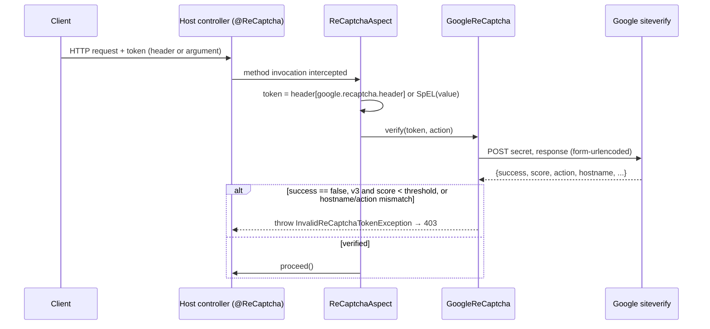

# reCAPTCHA Spring Integration — Architecture

Describes version `2.0.0-SNAPSHOT`.

## Purpose and scope

**Does**

- Verifies a reCAPTCHA token server-side before an annotated method runs, and rejects the call with
  `InvalidReCaptchaTokenException` (HTTP 403) when verification fails.
  (`aspect/ReCaptchaAspect.java#verifyCaptchaResponse`, `service/GoogleReCaptcha.java#verify`)
- Supports reCAPTCHA v2 (success flag only) and v3 (success flag plus score threshold).
  (`GoogleReCaptcha#verify`, `config/ReCaptchaProperties.java`)
- Optionally checks the token's `hostname` (`google.recaptcha.hostname`) and, for v3, its `action`
  (`@ReCaptcha(action)`). (`GoogleReCaptcha#verify`)
- Reads the token from a configurable request header or from a SpEL expression over the method
  arguments. (`ReCaptchaAspect`)

**Does not**

- Render the widget or obtain tokens on the client. That's up to the frontend.
- Expose any HTTP endpoint, persist data or cache verification results.

## Technical stack

Verified in `pom.xml`:

| Item | Value |
|---|---|
| Artefact | `gr.athenarc.recaptcha:recaptcha:2.0.0-SNAPSHOT` (jar) |
| Language level | Java 17 (`maven-compiler-plugin` `release`) |
| Spring | `spring-context`, `spring-web`, `spring-aspects` `6.2.19` |
| Servlet API | `jakarta.servlet-api` `6.0.0`, `provided` scope |
| JSON | `jackson-annotations` (the host supplies `jackson-databind` for `RestTemplate`) |
| Logging | `slf4j-api` 1.7.36; the host chooses the backend |
| Tests | JUnit 5, `spring-test` (`MockRestServiceServer`) |
| Build/release | Maven, `maven-release-plugin` 3.0.1, no Maven wrapper |

## Main modules and responsibilities

This is a single Maven module. The packages live under `src/main/java/gr/athenarc/recaptcha/`:

| Package | Responsibility |
|---|---|
| `annotation` | `@EnableReCaptcha` imports `ReCaptchaConfig`. `@ReCaptcha(value, action)` marks the methods to protect |
| `config` | `ReCaptchaConfig` component-scans `gr.athenarc.recaptcha`. `ReCaptchaProperties` binds and validates `google.recaptcha.*` |
| `aspect` | `ReCaptchaAspect` is an `@Around` advice on `execution(public * *(..)) && @annotation(ReCaptcha)` that extracts the token and calls the service |
| `service` | `ReCaptchaService` interface and its `GoogleReCaptcha` implementation, which calls Google's API |
| `exception` | `InvalidReCaptchaTokenException`, annotated `@ResponseStatus(HttpStatus.FORBIDDEN)` |
| root | `ReCaptchaResponse`, the DTO for the siteverify JSON reply |

## Interfaces

These are Java-level only. See [integration.md](integration.md).

- **Provided:** `@EnableReCaptcha`, `@ReCaptcha`, the `ReCaptchaService` bean and
  `InvalidReCaptchaTokenException`.
- **Consumed:** Google reCAPTCHA `siteverify` over HTTPS.

## Request flow

## Data and state

There's no persistence. `ReCaptchaProperties` and the `RestTemplate` held by `GoogleReCaptcha` are the
only state, both singletons built at startup.

## Security

See [security.md](security.md). In short, the shared secret is read from configuration and sent only
to the configured verification URL. A failed verification raises HTTP 403.

## Significant design decisions

- **Annotation-driven AOP instead of a servlet filter**, so protection is opt-in per method and works
  with any argument source through SpEL. (`ReCaptchaAspect`)
- **Fail fast at startup.** The application context won't start if `google.recaptcha.secret` is empty or
  `google.recaptcha.version` isn't 2 or 3, the threshold is outside 0.0–1.0, or a timeout isn't positive.
 (`ReCaptchaProperties` constructor)
